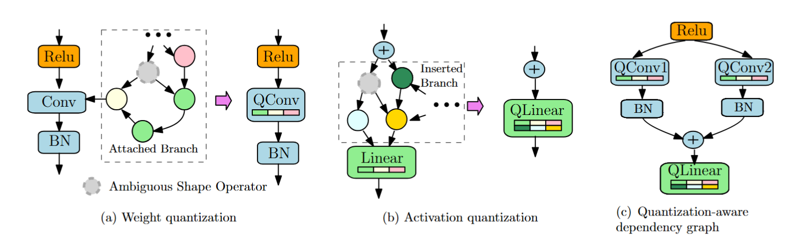

# GETA
This repo provides the implementation of **GETA**, a **G**eneric, **E**fficient **T**raining framework that **A**utomates joint structured pruning and mixed precision quantization. GETA is architecture agnostic and user-friendly. Using **GETA**, one can compress a wide range of neural network architecures including but not limited to convolutional neural networks, transformers, vision transformers, and small language models with minimal engineering efforts on the user side.

> **本仓库分支说明**
> 本仓库是 [microsoft/geta](https://github.com/microsoft/geta) 的 DACO 分支，在上游框架之上增加了：
> - **DACO 方法**：余弦剪枝预算调度 + RCAJS 位宽自适应 + MCSS 重要性平滑 + DGD 扩散噪声
> - **统一训练入口**：`train.py` + YAML 配置，baseline(纯 GETA) 与 DACO 可一键对比
> - **训练性能优化**：Adam 更新 foreach 批量化、量化算子去同步、投影路径索引缓存等（详见下文「训练性能」）
>
> 若只想使用上游 GETA 的库接口，本仓库完全兼容；若要复现 DACO 实验，从「训练入口」一节开始看。

## Features
The GETA framework features two essential modules, quantization-aware dependency graph (QADG) analysis and quantization-aware structured sparse optimizer (QASSO).

* Graph Analysis. **GETA** first constructs the pruning search space that supports structured pruning. Careful computational graph optimization is introduced to handle both weight quantization and activation quantization. The following figure visualizes the general idea of how graph analysis is performed.

  

* QASSO Optimizer. **GETA** next deploys **QASSO** optimizer to figure out the tradeoff between pruning and compression given the compression constraints. QASSO is a white-box optimizer for an optimization problem with both sparisty and quantization constraints, which is formulated as
```math
\begin{aligned}
\min_{x,d,q_m,t} & f(x, d, q_m, t) \\
\text{s.t.} & \text{Card}\{g \in \mathcal{G} \mid [{x}]_g = 0 \} = K, \\
& b_i \in [b_l, b_u], \quad i \in \mathcal{L},
\end{aligned}
```
where $\mathcal{G}$ represents the set of parameter groups and $K$ represents the target sparsity ratio and $[b_l, b_u]$ specifies the target bit width range, and $\mathcal{L}$ denotes the index set of layers that have parameterized quantization layers added. By white-box, one can explicity control the sparsity level $K$ and the bit width range $[b_l, b_u]$.

## Installation
We recommend to run the framework under `pytorch>=2.0` and to use `git clone` to install.

```bash
git clone https://github.com/microsoft/geta.git
```

## Quick Start

We provide an example of framework usage. More explained details can be found in [tutorials](./tutorials/).

### Minimal usage example. 

```python
from only_train_once.quantization.quant_model import model_to_quantize_model
from only_train_once.quantization.quant_layers import QuantizationMode
from sanity_check.backends.vgg7 import vgg7_bn
from only_train_once import OTO
import torch

# Create OTO instance
model = vgg7_bn()
model = model_to_quantize_model(model, quant_mode=QuantizationMode.WEIGHT_AND_ACTIVATION)
dummy_input = torch.rand(1, 3, 32, 32)
oto = OTO(model=model.cuda(), dummy_input=dummy_input.cuda())

# Create GETA optimizer
optimizer = oto.geta(
    variant="adam",
    lr=1e-3,
    lr_quant=1e-3,
    first_momentum=0.9,
    weight_decay=1e-4,
    target_group_sparsity=0.5,
    start_projection_step=0 * len(trainloader),
    projection_periods=5,
    projection_steps=10 * len(trainloader),
    start_pruning_step=10 * len(trainloader),
    pruning_periods=5,
    pruning_steps=10 * len(trainloader),
    bit_reduction=2,
    min_bit_wt=4,
    max_bit_wt=16,
)

# Train the DNN as normal via GETA
model.train()
model.cuda()
criterion = torch.nn.CrossEntropyLoss()
for epoch in range(max_epoch):
    f_avg_val = 0.0
    for X, y in trainloader:
        X, y = X.cuda(), y.cuda()
        y_pred = model.forward(X)
        f = criterion(y_pred, y)
        optimizer.zero_grad()
        f.backward()
        optimizer.step()

# A pruned and quantized vgg7 will be generated. 
oto.construct_subnet(out_dir='./')
```

## 训练入口：train.py + YAML

本仓库所有正式训练都走**唯一入口** `train.py`，配置全在 YAML 里改：

```bash
python train.py configs/compare_resnet20.yaml               # baseline vs DACO 对比
python train.py configs/compare_resnet20.yaml --modes daco  # 只跑 DACO 一侧
python train.py configs/compare_vgg7.yaml                   # 换成 VGG-7
python train.py configs/compare_resnet20.yaml --quick-test  # 冒烟: 1 epoch, 无 warmup/cooldown
```

优先级：**命令行 > YAML > 脚本内置默认值**。运行开始会把最终生效的完整配置快照到 `{out}/run_config.yaml`，日志同时写终端与 `{out}/train.log`。

### 三段训练调度

| 阶段 | 字段 | 做什么 |
| --- | --- | --- |
| warmup | `warmup_epochs` | 预热，不剪枝、不降位宽 |
| joint | `epochs` | 按 `prune_shape` 逐期剪枝 + 位宽自适应下降 |
| cooldown | `cooldown_epochs` | 压缩结构冻结，只做 finetune |

### 常用改动都在 YAML 内

| 想改什么 | 字段 | 取值 |
| --- | --- | --- |
| 换模型 | `model` | `resnet20` / `vgg7` |
| 换算法 | `modes` | `baseline`（纯 GETA，线性阶梯剪枝）/ `daco`（余弦剪枝）/ `baseline,daco` |
| 量化模式 | `quant_mode` | `weight_and_activation` / `weight_only` |
| 优化器 | `variant` / `lr` / `lr_quant` | **必须 `adam`**：量化参数梯度量级 ~1e9，`sgd` 会一步爆炸 |
| 剪枝形状 | `prune_shape` / `prune_floor` / `prune_budget` | DACO 用 `cosine`，baseline 恒为 `linear` |
| 压缩目标 | `compression.target_group_sparsity` 等 | 目标稀疏度、位宽上下界、`bit_reduction` |

新增实验 = 复制一个 `configs/compare_*.yaml` 改几行，不需要写新脚本。

### DACO 的三个组件

| 组件 | 作用 | 对应配置 |
| --- | --- | --- |
| **RCAJS** | 按位宽收缩比 `φ_b/φ_a` 自适应触发额外 bit reduction，并对剪枝速率做 Lagrangian 阻尼 | `phi_b_threshold` / `phi_a_threshold` / `beta_p` |
| **MCSS** | 对重要性分数做滑动窗口平滑（窗口 `W`、系数 `kappa`），抑制逐期抖动 | `kappa` / `W` |
| **DGD** | 训练中注入余弦衰减的扩散噪声 | `diffusion_noise_init` / `diffusion_noise_ratio` |

`baseline_override` 块定义了「纯 GETA」的关断配置（`phi=1.0`、`beta_p=0`、`kappa=0`、`noise=0`），保证对比实验中 baseline 一侧不受 DACO 影响。

### 压缩率 (CR) 口径

论文口径为 **BOPs 压缩率**，与 `DACO.tex` L389-395 一致：

$$\text{CR}_{\text{BOPs}} = \frac{32 \times 32}{(1-s)\cdot \bar{w}\cdot \bar{a}}$$

其中 `s` 为结构化剪枝比例，`w̄` / `ā` 为权重/激活平均位宽。该值每 epoch 记入 `*_history.jsonl` 的 `cr_bops` 字段，最终汇总在 `comparison_summary.csv` 的 `CR (BOPs)` 列。

> 日志里另有 `CR_old`（`(1-s)·16/w̄`），是早期漏掉激活位宽的遗留字段，仅作对照，**论文中请使用 BOPs 口径**。

## 训练性能

本分支相对上游做了以下优化，均为 Python 层改动、不改数值语义，并提供与旧实现的逐位对照开关：

| 优化点 | 位置 | 效果 |
| --- | --- | --- |
| Adam 更新 `_foreach_*` 批量化 | `optimizer/base_optimizer.py` | `opt.step` 34.7 → 9.0 ms（3.84x，`OTO_OPT_FOREACH=0` 可回退） |
| 量化反传去掉每层每步的 `.item()` 同步 | `quantization/quant_layers.py` | `backward` 77.3 → 47.7 ms |
| `_d_quant_helper` 张量化 | `optimizer/geta.py` | joint 阶段上千次/步 GPU 同步清零 |
| 投影路径改用参数索引缓存 | `optimizer/geta.py` | 去掉 O(L×P) 字符串子串扫描 |
| `div` → `mul`、原地 `clamp_` / `masked_fill` | `quantization/quant_layers.py` | 少 2~3 个逐元素 kernel |
| `clip_val` 注册为 buffer | `quantization/quant_layers.py` | 消除每步上百次 H2D 拷贝 |

合计（量化 ResNet-20 + GETA，bs=128）：**141.1 → 76.9 ms/step，约 −45%**。耗时结构为 `backward 47.7ms (62%) > forward 19.8ms (26%) > opt.step 9.0ms (12%)`。

两条约束：

1. **不要引入同步点**（`.item()` / `.tolist()`）。GPU 同步代价远大于多几个 kernel —— 实测「批量算 16 kernel + 一次 `tolist`」比「逐层算 352 kernel 但全异步」反而慢 22~29%。
2. **`torch.copysign` 无法导出 ONNX opset 16**，会阻断 deployment 链路，量化算子中禁用。

# Issues
We are adding more information to the tutorials folder. Stay tuned. Thanks for patience.

## Instructions to contributors
We would greatly appreciate the contributions in any form, such as bug fixes, new features and new tutorials, from our open-source community.

## BibTeX
If you find this repo useful for your research, please consider citing our paper:

```
@article{qu2025automatic,
  title={Automatic Joint Structured Pruning and Quantization for Efficient Neural Network Training and Compression},
  author={Qu, Xiaoyi and Aponte, David and Banbury, Colby and Robinson, Daniel P and Ding, Tianyu and Koishida, Kazuhito and Zharkov, Ilya and Chen, Tianyi},
  journal={arXiv preprint arXiv:2502.16638},
  year={2025}
}
```


